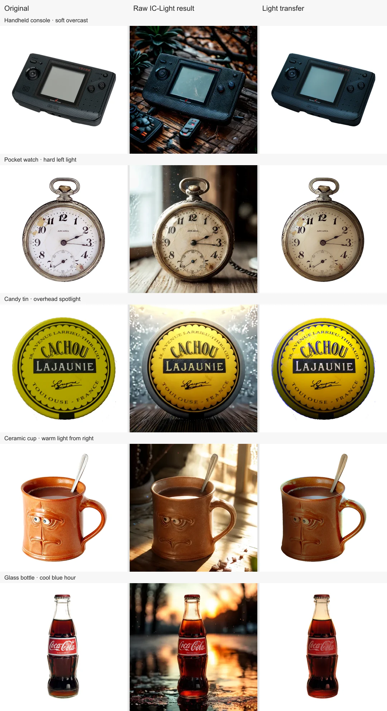
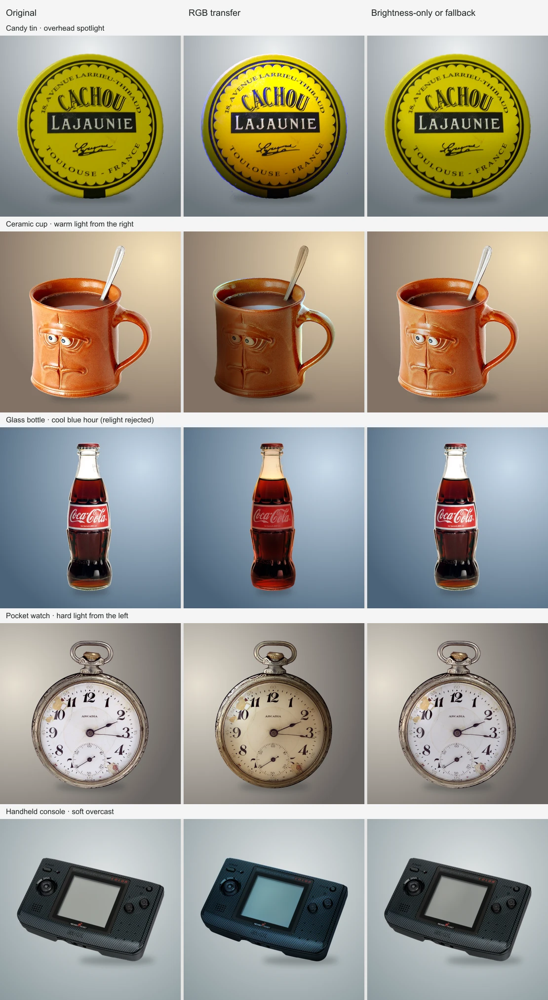

# Hosted image models for the ad editor

Researched 2026-11-13. All prices are list prices read on that date from the cited page. Every claim has a URL. Anything marked **UNVERIFIED** could not be confirmed from a primary source. Latency figures are scarce in primary docs, so treat them all as "measure before you commit."

Assumptions used for cost maths: uploads are downscaled to a 2048 px long edge, so a 4:3 image is 2048x1536 ≈ **3.1 MP** and a square image is 2048x2048 ≈ **4.2 MP**.

---

## 0. Providers at a glance (data handling and API access)

| Provider | Trains on API inputs? | Retention of inputs/outputs | JS/HTTP |
|---|---|---|---|
| **fal.ai** | Terms don't say directly. You license inputs to fal "to provide the Services", but fal may use anonymized/aggregated "Usage Data … derived from Customer Input" to develop "AI models" ([terms](https://fal.ai/terms)). | Request inputs/outputs kept **90 days** by default. Turn this off per request with header `X-Fal-Store-IO: 0`. CDN media lifetime is set with `X-Fal-Object-Lifecycle-Preference`. Zero data retention is not on by default ([data retention](https://fal.ai/docs/model-apis/data-retention)). | Official JS client ([fal-js](https://github.com/fal-ai/fal-js)), plus HTTP queue API. Per-model docs at `fal.ai/models/<id>/llms.txt`. |
| **Replicate** | Customer data may be used to "train and generate Customer Derivative Models" (your own fine-tunes); it may use aggregated/anonymized "Resultant Data" to improve services. Third-party "Marketplace Models" fall under their own terms ([terms](https://replicate.com/terms)). | API prediction inputs/outputs are deleted after **1 hour** by default ([data retention](https://replicate.com/docs/topics/predictions/data-retention)). | Official JS client ([replicate-javascript](https://github.com/replicate/replicate-javascript)). |
| **Black Forest Labs (direct API)** | **Yes, by default.** "the Company may use Inputs and Outputs to train and improve its artificial intelligence models" ([API service terms](https://bfl.ai/legal/flux-api-service-terms)). To opt out, email privacy@blackforestlabs.ai with the subject "Training Opt Out" ([privacy policy](https://bfl.ai/privacy-policy)). | Result URLs expire after 10 min ([integration guide](https://docs.bfl.ml/api_integration/integration_guidelines.md)). Server-side retention period is not stated, only "as long as is reasonably necessary" ([privacy policy](https://bfl.ai/privacy-policy)). | HTTP only (async submit + poll). EU and US regional endpoints exist ([integration guide](https://docs.bfl.ml/api_integration/integration_guidelines.md)). |
| **OpenAI Images API** | No, unless you opt in ([your data](https://developers.openai.com/api/docs/guides/your-data)). | Abuse-monitoring logs kept up to 30 days. Image edits are ZDR-eligible with approval ([your data](https://developers.openai.com/api/docs/guides/your-data)). | Official SDKs and HTTP. |
| **Google Gemini API (paid tier)** | No. Paid tier: "Google doesn't use your prompts … or responses to improve our products" ([terms](https://aistudio.google.com/docs/terms)). The free tier *is* used for training. | Kept 55 days for abuse monitoring ([usage policies](https://aistudio.google.com/docs/usage-policies)). | Official SDKs and HTTP. |
| **Google Cloud Vision** | No: "Google does not use the content you send to train and improve our Cloud Vision features" ([data usage](https://docs.cloud.google.com/vision/docs/data-usage)). | Online (sync) requests are processed in memory and not written to disk ([data usage](https://docs.cloud.google.com/vision/docs/data-usage)). | Node client and REST. |
| **AWS Textract / Rekognition** | **May be used for service improvement and model training by default.** You opt out through an AWS Organizations AI-services opt-out policy ([AWS docs](https://docs.aws.amazon.com/organizations/latest/userguide/orgs_manage_policies_ai-opt-out.html)). | Not stated on that page. | AWS SDK. |
| **Stability AI** | You can opt out with the Platform API toggle "Training: Improve the Model for Everyone". The default is **UNVERIFIED** ([privacy center](https://stability.ai/privacy-center)). | Retention for Platform API not stated (**UNVERIFIED**). | HTTP (multipart). |
| **Photoroom** | "Photoroom doesn't save the images that are processed through the Photoroom API" ([FAQ](https://docs.photoroom.com/getting-started/frequently-asked-questions.md)). Whether Photoroom trains on API inputs isn't stated (**UNVERIFIED**). | Not saved (same FAQ). | HTTP. |

On fal and Replicate, it is **UNVERIFIED** whether partner-hosted models (BFL, Bria, Google, OpenAI) pass your images on to the partner, or which partner's data terms then apply. Replicate's FLUX Fill page says that using it means you agree to the BFL API agreement ([Replicate flux-fill-pro](https://replicate.com/black-forest-labs/flux-fill-pro)). Assume the same could hold on fal.

---

## 1. Subject segmentation with tap-to-refine

What we need: positive and negative clicks that give a mask, then a soft alpha matte good enough for hair.

| Candidate | Provider | Clicks? | Output | Price (2026-11-13) | Notes |
|---|---|---|---|---|---|
| **SAM 3 image** (`fal-ai/sam-3/image`) | fal | Yes. `point_prompts` with `label` 1 = foreground, 0 = background, plus `object_id` to refine the same object; also boxes and text ([OpenAPI](https://fal.ai/api/openapi/queue/openapi.json?endpoint_id=fal-ai/sam-3/image), [llms.txt](https://fal.ai/models/fal-ai/sam-3/image/llms.txt)) | PNG masks, optional scores/boxes, up to 32 masks | **$0.005 / request** ([llms.txt](https://fal.ai/models/fal-ai/sam-3/image/llms.txt)) | Model supports text, point, box and mask prompts ([sam3 repo](https://github.com/facebookresearch/sam3)). Masks are segmentation masks, not a hair-quality alpha matte (no matte output is documented). Tagged "real-time"; no latency numbers given. |
| SAM 2 image (`fal-ai/sam2/image`) | fal | Yes, `label` 1 = foreground, 0 = background ([OpenAPI](https://fal.ai/api/openapi/queue/openapi.json?endpoint_id=fal-ai/sam2/image)) | PNG mask | Listed as "$0 per compute seconds", **real rate UNVERIFIED** ([llms.txt](https://fal.ai/models/fal-ai/sam2/image/llms.txt)) | Superseded by SAM 3. |
| `meta/sam-2` | Replicate | **No.** The schema only exposes automatic mask generation (`points_per_side`) ([schema](https://replicate.com/meta/sam-2/api/schema)) | Masks | ~$0.032/run, "typically complete within 34 seconds" on L40S ([model page](https://replicate.com/meta/sam-2)) | Too slow, and no clicks. Rejected. |
| **Bria RMBG 2.0** (`fal-ai/bria/background/remove`) | fal | No clicks. An optional text prompt can add, drop or narrow what the cutout keeps | Cutout | **$0.018/image**, or $0.03 with a prompt ([llms.txt](https://fal.ai/models/fal-ai/bria/background/remove/llms.txt)) | Automatic matting; use it as the matte source. |
| BiRefNet v2 (`fal-ai/birefnet/v2`) | fal | No | Cutout + optional mask. Variants include `Matting`, `Portrait`, `General Use (Dynamic)`; operating resolution up to 2048 or 2304 ([llms.txt](https://fal.ai/models/fal-ai/birefnet/v2/llms.txt)) | "$0 per compute seconds", **real rate UNVERIFIED** | MIT license. HR-matting variant trained at 2048x2048 ([repo](https://github.com/ZhengPeng7/BiRefNet)). |
| Photoroom Remove Background | Photoroom | No | Cutout | $0.02/image (Basic) ([pricing](https://www.photoroom.com/api/pricing)) | Median latency 350 ms (per Photoroom docs, via [AI Backgrounds](https://docs.photoroom.com/image-editing-api-plus-plan/ai-backgrounds.md)). Extra account. |

**Recommended pipeline:** At upload, run Bria RMBG 2.0 for an automatic soft matte (good at hair). When the user taps, run SAM 3 with the click points to get a binary *selection*. The final matte is `RMBG alpha × dilate(SAM mask)`, plus `SAM mask` where RMBG missed the object. That way clicks choose *which* subject, and the matting model supplies the edge quality. Combining the two is our own design and its quality is **UNVERIFIED**, so test it on hair and on fur.

---

## 2. Background replacement around a preserved subject

| Candidate | Provider | Price | Notes |
|---|---|---|---|
| **Bria Background Replace** (`fal-ai/bria/background/replace`) | fal | **$0.04 / generation** ([llms.txt](https://fal.ai/models/fal-ai/bria/background/replace/llms.txt)) | Takes a text prompt or reference image. "Trained exclusively on licensed data." Subject preservation is not guaranteed in the docs, so composite our matte back on top anyway. |
| Bria Product Shot (`fal-ai/bria/product-shot`) | fal | $0.04 / generation ([llms.txt](https://fal.ai/models/fal-ai/bria/product-shot/llms.txt)) | `placement_type: original` keeps the position, and `original_quality` keeps the input size. Otherwise output is ~1 MP. Aimed at e-commerce. |
| **FLUX.1 Fill [pro]** (inpaint with inverted subject mask) | fal / BFL | fal: **$0.05 / MP** ([llms.txt](https://fal.ai/models/fal-ai/flux-pro/v1/fill/llms.txt)), so ≈ $0.16 at 3.1 MP if billed on output. BFL direct: $0.05/image flat ([BFL pricing](https://bfl.ai/pricing)) | Most control: background-only mask plus prompt. Direct BFL trains on inputs by default (section 0). |
| FLUX.2 [pro] edit | BFL | $0.03 first MP + $0.015 per additional MP + $0.015/MP per reference image ([BFL pricing](https://bfl.ai/pricing)) | Instruction edit; regenerates the full frame (see section 7). |
| Photoroom AI Backgrounds | Photoroom | Plus plan, $0.10/image ([pricing](https://www.photoroom.com/api/pricing)) | Prompt or guidance image. About 5 s in Photoroom's own benchmark ([benchmark](https://docs.photoroom.com/resources/ai-backgrounds-competitors-benchmark-claid.ai-phot.ai-bria.ai.md)). Pixel-exact subject not guaranteed ([AI Backgrounds](https://docs.photoroom.com/image-editing-api-plus-plan/ai-backgrounds.md)). |
| Stability Replace Background & Relight | Stability | 8 credits = **$0.08** ([pricing](https://docs.stability.ai/pricing)) | Does background *and* relight in one call. `preserve_original_subject` 1.0 = "exact pixel match"; async, poll no faster than every 10 s; input up to 9.4 MP ([API ref](https://docs.stability.ai/api-reference/edit/replace-background-and-relight-async.md)). |
| IC-Light v2 (`fal-ai/iclight-v2`) | fal | $0.10 / MP of output ([llms.txt](https://fal.ai/models/fal-ai/iclight-v2/llms.txt)) | Generates the background from a prompt *and* relights. See section 3. |

**Resolution note:** most generators work natively near 1 MP (for example, FLUX Erase was trained at ~1 MP ([BFL docs](https://docs.bfl.ml/flux_tools/flux_erase.md))). Because the subject stays at full resolution from the original, a slightly softer generated background reads as shallow depth of field. That is acceptable and cheaper than paying per-MP at 4 MP. (Design judgement, not a sourced claim.)

---

## 3. Relighting the subject to match the new background

**Conflict with the core rule:** relighting *by definition* changes subject pixels. Every relight model regenerates the subject through a diffusion model, so it can soften product text, logos and textures. Options:

- **Low-frequency transfer (recommended, our own design, UNVERIFIED quality):** run the relight model, then compute `gain = blur(relit) / blur(original)` inside the matte and multiply the *original* subject pixels by it. Light direction and colour cast change, but every edge, letter and texture comes from the original pixels.
- Or skip relighting and do colour/levels matching of the subject to the background in-app (no API cost).

| Candidate | Provider | Price | Notes |
|---|---|---|---|
| **IC-Light v2** (`fal-ai/iclight-v2`) | fal | $0.10 / MP output ([llms.txt](https://fal.ai/models/fal-ai/iclight-v2/llms.txt)) | Flux-based. Weights not released (author says the licence would be non-commercial), so it is API-only via fal ([discussion](https://github.com/lllyasviel/IC-Light/discussions/98)). Inputs: prompt, `initial_latent` light direction (Left/Right/Top/Bottom), optional mask. **It does not take a background image**; it generates its own ([llms.txt](https://fal.ai/models/fal-ai/iclight-v2/llms.txt)). |
| IC-Light v1 background-conditioned (`zsxkib/ic-light-background`) | Replicate | ~$0.057/run, "typically complete within 59 seconds" ([model page](https://replicate.com/zsxkib/ic-light-background)) | Takes *our* background image, which is the right shape for the problem. SD1.5-based, Apache-2.0 ([repo](https://github.com/lllyasviel/IC-Light)). **59 s breaks the 30 s budget.** |
| **Bria FIBO Edit Relight** (`bria/fibo-edit/relight`) | fal | **$0.04 / image** ([llms.txt](https://fal.ai/models/bria/fibo-edit/relight/llms.txt)) | Structured inputs: `light_direction` plus `light_type` enum (for example "low-angle sunlight", "overcast light", "harsh studio lighting"). The planner can map a scene to these enums. Licensed training data. |
| Stability Replace Background & Relight | Stability | $0.08 ([pricing](https://docs.stability.ai/pricing)) | `light_reference` image or `light_source_direction`; `keep_original_background` relights without swapping ([API ref](https://docs.stability.ai/api-reference/edit/replace-background-and-relight-async.md)). Can use our generated background as `background_reference`. Extra account. |
| Photoroom AI Relight | Photoroom | Plus plan, $0.10 ([pricing](https://www.photoroom.com/api/pricing)) | Exposure correction only (`ai.auto`, `ai.preserve-hue-and-saturation`, `ai.optimize-portrait`); not documented as matching a background ([AI Relight](https://docs.photoroom.com/image-editing-api-plus-plan/ai-relight.md)). Not a fit. |

### Prototype verdict

**Works with caveats.** For #8, use the bounded brightness-only transfer for subtle exposure matching when the relight is aligned and its lighting matches the scene. The original color and matte carry through. If the relight shifts the subject or misses the requested light, keep the original subject lighting. Large changes in lighting direction still need validation.

#### Live IC-Light results

The free [IC-Light demo](https://huggingface.co/spaces/lllyasviel/IC-Light) generated one result per photo at 512 × 512 with seed 12345, 20 steps, CFG 2, and high-resolution scale 1. The source photos were centered with their alpha mattes. The model received the same frames flattened onto white, and the transfer used the original alpha and radius 16. The Bria FIBO endpoint and 2048 px inputs remain unverified.

| Original photo | Target light and initial latent | Observation |
|---|---|---|
| [Handheld console by OliverGalvin](https://commons.wikimedia.org/wiki/File:Neo-Geo-Pocket-Color-Anthra-Left.png) | Soft overcast daylight, None | A cool shift carried onto the screen and case. The original logo and case texture remained sharp, and scratches introduced by the model were absent from the transfer. |
| [Arcadia watch by suebun](https://commons.wikimedia.org/wiki/File:1859pocketwatch.png) | Hard studio light from the left, Left Light | The original dial, logo, and worn spots remained visible after transfer, with a darker right edge. |
| [Candy tin by Michel VENOT](https://commons.wikimedia.org/wiki/File:Cachou_lajaunie.png) | Overhead spotlight, Top Light | The original lettering survived, with a blue edge fringe and clipped yellow highlights where the raw render changed the lid and rim. |
| [Ceramic cup by Aka and Romainhk](https://commons.wikimedia.org/wiki/File:Tasse_de_chocolat.png) | Low warm morning light from the right, Right Light | The face, spoon, and handle kept their original forms. The handle and rim picked up a cool fringe from the relight. |
| [Cola bottle by Jorgebarrios and RanZag](https://commons.wikimedia.org/wiki/File:CocaColaBottle_background_free.png) | Cool blue hour, None | The original label and bottle shape survived. The transfer carried the model's warm backlight, so it missed the requested cool target. |



The comparison resizes and relights the credited photos and is shared under [CC BY-SA 3.0](https://creativecommons.org/licenses/by-sa/3.0/). The console source is [CC0](https://creativecommons.org/publicdomain/zero/1.0/).

#### Comparison on shared backdrops

Each row uses the same studio backdrop and shadow for all three versions. Brightness-only transfer computes one gain from blurred linear luminance, limits it to about ±0.43 stops, and tapers it near the matte boundary. It scales all three channels equally in linear light and caps the gain before any channel clips.



The tin loses the purple fringe and keeps the yellow label. The cup loses the cyan rim and handle fringe, with a much smaller lighting change than the RGB transfer. The bottle shows the original lighting in the last panel because the model produced warm backlight for a cool-blue target. The backdrop comparison uses the same credited photos and [CC BY-SA 3.0](https://creativecommons.org/licenses/by-sa/3.0/).

Pass a backdrop as the fifth argument to compare the original, RGB transfer, and brightness-only transfer. Append `--reject-relight` when visual review rejects the model output. The last panel then keeps the original subject lighting.

```sh
npx --no-install jiti scripts/compare-relight.ts original.png relit.png comparison.png 16 backdrop.png
```

#### Published comparison results

The prototype also replayed published [LightSwitch results](https://yehonathanlitman.github.io/light_switch/#scene-pills) on [Objects With Lighting](https://github.com/isl-org/objects-with-lighting), plus one Neural Gaffer output from the same gallery as a stress case. The [LightSwitch paper](https://openaccess.thecvf.com/content/ICCV2025/html/Litman_LightSwitch_Multi-view_Relighting_with_Material-guided_Diffusion_ICCV_2025_paper.html) reports two target environment maps per object for this benchmark. Panels were 320 × 288 with an approximate foreground matte from the original white background.

| Object | Clip time | Observation |
|---|---:|---|
| Painted figurine | 1.5 s | Warmer light carried over and the original suit seams and paint edges remained visible. |
| Chest with metal fittings | 4.5 s | The light shift was subtle. The original panel joins and fittings remained defined. |
| Gamepad | 1.5 s | The tint shifted while button outlines and the thin orange trim stayed visible. |
| Patterned porcelain mug | 3.0 s | Cooler light carried over and the original band pattern stayed distinct. |
| Wooden bowl | 4.5 s | The strong cool shift kept the grain that the raw result softened, with a narrow colored fringe at the rim. |
| Gamepad, Neural Gaffer | 1.5 s | The original shape survived, but a bright patch in the raw result became false shading on the grip. |

To regenerate a comparison from an original with an alpha matte and a same-size, aligned relight, run this from the repo after `npm ci`. Pass `8` for the small gallery crops or omit the radius to use the app default of `16`.

```sh
npx --no-install jiti scripts/compare-relight.ts original.png relit.png comparison.png 8
```

The panels show original, raw relight, and transfer from left to right. For the gallery comparisons, crop each selected frame to 320 × 288 starting at y=48. The input column starts at x=1280, LightSwitch at x=320, and Neural Gaffer at x=960. Starting at the input crop's border, flood-fill connected pixels with all RGB channels at least 250 to zero alpha.

---

## 4. Contact shadows and reflections

No hosted API was found that takes *our* composite plus a subject mask and only adds a contact shadow. Options:

| Approach | Price | Notes |
|---|---|---|
| **Client/server-side synthetic shadow from the matte** | $0 | Squash, blur and offset the alpha; multiply onto the background below the subject. Deterministic, never touches the subject. Covers the common product-on-surface case. Our own design. |
| **Masked inpaint of a band where the subject meets the surface** (FLUX.1 Fill [pro], prompt "soft contact shadow …", mask = dilated subject bottom edge minus the subject) | fal $0.05/MP ([llms.txt](https://fal.ai/models/fal-ai/flux-pro/v1/fill/llms.txt)) | Generative shadow/reflection; subject untouched because it is outside the mask. Quality **UNVERIFIED**. |
| **Instruction edit on the composite, then re-composite the original subject** (Nano Banana 2 / FLUX Kontext, see section 7) | $0.04–$0.12 | Usually gives the most natural shadows and reflections, because the model sees the whole scene. Anything the model draws *outside* the matte survives the re-composite. |
| Photoroom AI Shadows | Plus, $0.10 ([pricing](https://www.photoroom.com/api/pricing)) | Modes `ai.soft`/`ai.hard`/`ai.floating`, and a 2026-04-15 model with direction/softness/intensity overrides ([AI Shadows](https://docs.photoroom.com/image-editing-api-plus-plan/ai-shadows.md)). Examples only show solid-colour backgrounds; whether it works on an arbitrary existing background is **UNVERIFIED**. |
| Bria Product Shot | $0.04 | No shadow controls documented ([llms.txt](https://fal.ai/models/fal-ai/bria/product-shot/llms.txt)). |

---

## 5. Text detection + text removal

### Detection (OCR with boxes)

| Candidate | Price | Notes |
|---|---|---|
| **Google Cloud Vision `TEXT_DETECTION`** | First 1,000 units/month free, then **$1.50 / 1,000** (= $0.0015/image) up to 5M ([pricing](https://cloud.google.com/vision/pricing)) | Returns word/line boxes. Not used for training, and sync requests aren't written to disk ([data usage](https://docs.cloud.google.com/vision/docs/data-usage)). It does **not** classify overlay vs in-scene text. |
| AWS Rekognition `DetectText` | The pricing page's worked example shows $0.0010/image for the first 1M images; exact tier for DetectText **UNVERIFIED** ([pricing](https://aws.amazon.com/rekognition/pricing/)) | Inputs may be used for training unless you opt out through Organizations ([AWS docs](https://docs.aws.amazon.com/organizations/latest/userguide/orgs_manage_policies_ai-opt-out.html)). |
| AWS Textract `DetectDocumentText` | $0.0015/page (US West) ([pricing](https://aws.amazon.com/textract/pricing/)) | Built for documents, a poor fit for photos. Same training opt-out issue. |
| Florence-2 OCR with region (`fal-ai/florence-2-large/ocr-with-region`) | "$0 per compute seconds", **real rate UNVERIFIED** ([llms.txt](https://fal.ai/models/fal-ai/florence-2-large/ocr-with-region/llms.txt)) | Would keep everything on fal. OCR quality vs Google **UNVERIFIED**. |

**Overlay vs in-scene:** none of the OCR APIs classify this. Send the OCR boxes to the Claude planner (which already sees the image) and have it label each box as overlay (flat graphic text, added later) or in-scene (sign, packaging, clothing). This is our own design, and its accuracy is **UNVERIFIED**. **Photoroom** is the only API found that does this natively: `textRemoval.mode` = `ai.artificial` (added text such as names, watermarks, discounts), `ai.natural` (signs, clothing) or `ai.all` ([AI Text Removal](https://docs.photoroom.com/image-editing-api-plus-plan/ai-text-removal.md)). It is billed at the Plus rate, $0.10 ([pricing](https://www.photoroom.com/api/pricing)), and is a removal call, not a detector.

### Removal

Use the same erase models as section 6, with a mask built from the chosen boxes (dilated a few px). `fal-ai/image-editing/text-removal` ($0.04, [llms.txt](https://fal.ai/models/fal-ai/image-editing/text-removal/llms.txt)) removes *all* text with no mask, which would wipe in-scene text and product labels. Avoid it.

---

## 6. Object removal from a brush mask

| Candidate | Provider | Price | Notes |
|---|---|---|---|
| **Bria Eraser (FIBO-Edit-1.5)** (`bria/fibo-edit-1.5/eraser`) | fal | **$0.04 / image** ([llms.txt](https://fal.ai/models/bria/fibo-edit-1.5/eraser/llms.txt)) | Output is the input's own size ("tested at 3072x3840"), so it is safe at 2048 px. Licensed data. The older `fal-ai/bria/eraser` has `mask_type: manual` for brush masks ([llms.txt](https://fal.ai/models/fal-ai/bria/eraser/llms.txt)). |
| **FLUX Erase** (`fal-ai/flux-pro/v1/erase` or BFL direct) | fal / BFL | $0.03 first MP + $0.004 per additional MP; reference MP $0.004 with a "3 MP minimum" ([fal llms.txt](https://fal.ai/models/fal-ai/flux-pro/v1/erase/llms.txt), [BFL pricing](https://bfl.ai/pricing)). At 3.1 MP that is ≈ $0.04–$0.05 (exact reference-MP billing is ambiguous) | No prompt needed; `dilate_pixels` 0–25. Trained at ~1 MP, so quality may drop far from that ([BFL docs](https://docs.bfl.ml/flux_tools/flux_erase.md)). fal describes it as removing "objects, texts". |
| Finegrain Eraser (`fal-ai/finegrain-eraser/mask`) | fal | $0.04 express / $0.13 standard (default) / $0.22 premium ([llms.txt](https://fal.ai/models/fal-ai/finegrain-eraser/mask/llms.txt)) | Also removes the object's shadows and reflections. Remember to set `mode: express`, or you pay the $0.13 default. |
| fal Object Removal (`fal-ai/object-removal/mask`) | fal | $0.006 / $0.012 / $0.018 / $0.024 (low to best quality) ([llms.txt](https://fal.ai/models/fal-ai/object-removal/mask/llms.txt)) | Cheapest. Underlying model and quality **UNVERIFIED**. |
| Stability Erase | Stability | 5 credits = $0.05 ([pricing](https://docs.stability.ai/pricing)) | Mask or alpha; `grow_mask` 0–20; output "4 megapixels" ([API ref](https://docs.stability.ai/api-reference/edit/erase.md)). |

---

## 7. One instruction-editing model for several operations?

Candidates (all regenerate the whole frame):

| Model | Price | Source |
|---|---|---|
| Nano Banana 2 (`gemini-3.1-flash-image`) | Google direct: $0.067 at 1K, **$0.101 at 2K**. fal: $0.08, ×1.5 at 2K = $0.12 | [Gemini pricing](https://aistudio.google.com/docs/pricing), [fal llms.txt](https://fal.ai/models/fal-ai/nano-banana-2/edit/llms.txt) |
| Nano Banana 2.1 | Google direct: $0.0336 at 1K, **$0.0504 at 2K** | [Gemini pricing](https://aistudio.google.com/docs/pricing) |
| FLUX.1 Kontext [pro] | $0.04/image | [BFL pricing](https://bfl.ai/pricing), [fal llms.txt](https://fal.ai/models/fal-ai/flux-pro/kontext/llms.txt) |
| FLUX.2 [pro] | $0.03 first MP + $0.015 per additional MP | [BFL pricing](https://bfl.ai/pricing) |
| FLUX 3 Image edit | $0.048 at 1K, $0.10 at 2K | [BFL pricing](https://bfl.ai/pricing) |
| Qwen Image Edit 2511 | $0.03/MP | [fal llms.txt](https://fal.ai/models/fal-ai/qwen-image-edit-2511/llms.txt) |
| GPT Image 2 edit | $0.053 medium / $0.211 high at 1024² | [OpenAI guide](https://developers.openai.com/api/docs/guides/image-generation). Masks are only "guidance" and the model "may not follow its exact shape" (same page). |

**Trade-off.** A single call like "put this bottle on a marble counter at sunset" can do background, relight, shadow and reflection *coherently*, which is the hardest thing to get from separate models. The cost is that the subject is regenerated: labels, logos and fine text drift. That is exactly what the core rule forbids.

**Composite-back resolves most of it:** run the instruction edit, then paste the original subject through the matte. Background, shadows and reflections (all outside the matte) are kept. You lose two things:
1. **Any relight on the subject.** Recover it with the low-frequency gain transfer in section 3.
2. **Geometry drift.** If the model moves or rescales the subject, the pasted original no longer lines up with the generated shadow. Instruction editors don't guarantee pixel-aligned output (OpenAI says so explicitly for masks; for the others it is **UNVERIFIED**). Mitigation: check alignment by IoU between the original matte and a fresh RMBG matte of the output. If they disagree, fall back to the layered pipeline.

**Verdict:** use one instruction editor as the **"scene" step** (background + shadow/reflection in a single call, with the subject composited back), and keep dedicated mask-based models for erase and text removal, where they are cheaper and leave everything else untouched.

---

## 8. Recommendations

### Pick per operation

| # | Operation | Pick | Fallback |
|---|---|---|---|
| 1 | Segmentation + taps | **fal SAM 3** (clicks, $0.005) + **fal Bria RMBG 2.0** (matte, $0.018) | BiRefNet HR-matting on fal (price UNVERIFIED) |
| 2 | Background replacement | **Nano Banana 2.1 at 2K** (Google direct, $0.0504), or **Bria Background Replace** on fal ($0.04); composite the subject back | FLUX.1 Fill [pro] on fal with background-only mask (~$0.16 at 3.1 MP) for maximum control |
| 3 | Relight | **Bria FIBO Edit Relight** on fal ($0.04), applied as a low-frequency gain over the original pixels | IC-Light v2 on fal ($0.10/MP; generates its own background, so use gain transfer only) |
| 4 | Contact shadow/reflection | **Free synthetic shadow from the matte** by default; for "hero" shots, comes for free with the instruction-edit scene step in #2 | FLUX.1 Fill band inpaint |
| 5 | Text detect + remove | **Google Cloud Vision** OCR ($0.0015) + Claude labels overlay vs in-scene + **Bria Eraser** on fal ($0.04) | Photoroom `ai.artificial` ($0.10, extra account) |
| 6 | Object removal | **Bria Eraser (FIBO-Edit-1.5)** on fal ($0.04, full-res output) | FLUX Erase on fal (~$0.04–0.05), Finegrain `express` ($0.04) |

### Minimal provider set

- **fal.ai** (one account): SAM 3, RMBG 2.0, Bria Background Replace / Relight / Eraser, FLUX Fill/Erase, Nano Banana 2 (fal also proxies Google and BFL models, so no separate BFL account is needed).
- **Google Cloud** (one account): Vision OCR. Optionally the Gemini API, for Nano Banana 2.1 direct (cheaper at 2K, and a clear no-training policy on the paid tier).
- Anthropic: already in use for the planner.

So that is **two new accounts** (fal + Google Cloud). To get down to one, use fal's Florence-2 OCR instead of Google Vision, but its price and quality are UNVERIFIED.

Avoid BFL direct (trains on inputs by default) and AWS (trains unless you opt out through Organizations), unless you complete the opt-outs. On fal, send `X-Fal-Store-IO: 0` and a short `X-Fal-Object-Lifecycle-Preference`. Its default is 90-day retention.

### Estimated cost (list prices, 2026-11-13; 2048x1536 ≈ 3.1 MP)

**One-time per upload**

| Step | Cost |
|---|---|
| RMBG 2.0 matte | $0.018 |
| SAM 3, ~1–3 refine taps | $0.005–$0.015 |
| Google Vision OCR | $0.0015 (free for the first 1,000/month) |
| **Total** | **≈ $0.025–$0.035** |

**Per prompt (2–4 operations)**

| Typical prompt | Ops | Cost |
|---|---|---|
| "New background + match lighting" | Bria BG replace $0.04 + Bria relight $0.04 + synthetic shadow $0 | **≈ $0.08** |
| "Remove the price text and the cup" | 2 × Bria Eraser (or 1 call with a merged mask) | **$0.04–$0.08** |
| "Hero shot on marble at sunset, remove old text" | Nano Banana 2 on fal at 2K $0.12 (scene + shadow) + Bria relight $0.04 + Bria Eraser $0.04 | **≈ $0.20** |
| Max-control background | FLUX Fill on fal ~$0.16 + relight $0.04 + erase $0.04 + band-shadow fill ~$0.05–0.16 | **≈ $0.29–$0.40** |

**Planning figure: ~$0.08–$0.20 per prompt, ~$0.03 per upload.** This excludes Claude planner tokens and Vercel/Supabase costs.

### Latency (30 s budget)

Primary latency data is thin. The known numbers are Photoroom background removal at 350 ms median, Photoroom AI Backgrounds at ~5 s in its own benchmark, Replicate SAM 2 at ~34 s, and Replicate IC-Light v1 at ~59 s (sources above). Everything on fal is **UNVERIFIED**. Run independent operations in parallel (for example, erase and background generation on separate layers), and benchmark each chosen endpoint on 2048 px inputs before locking the pipeline. Stability's async API asks for polling no faster than every 10 s, which adds latency.
